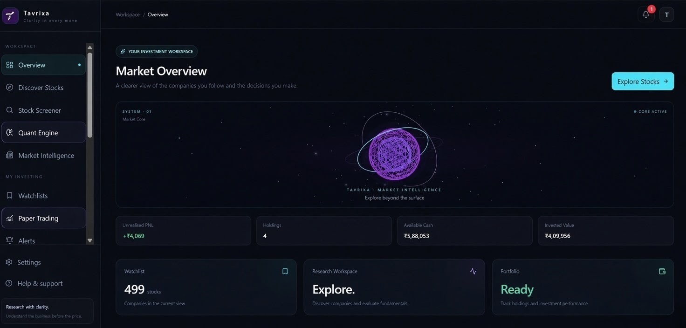
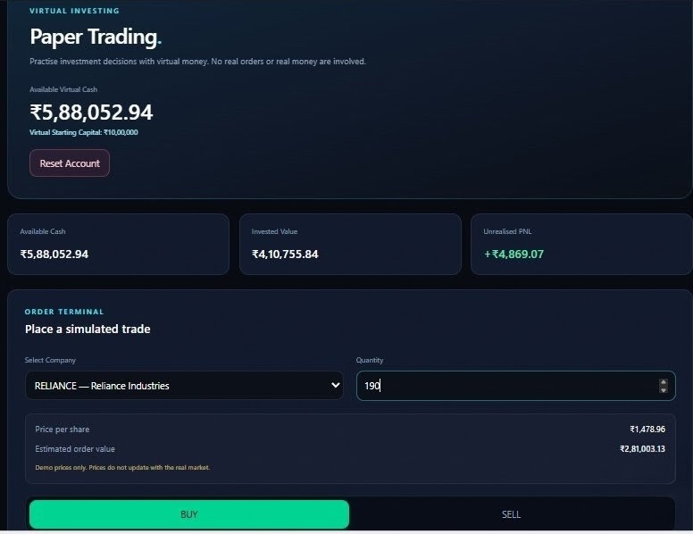
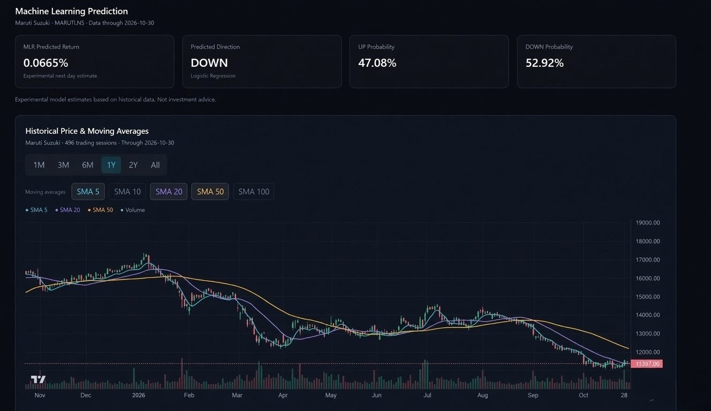
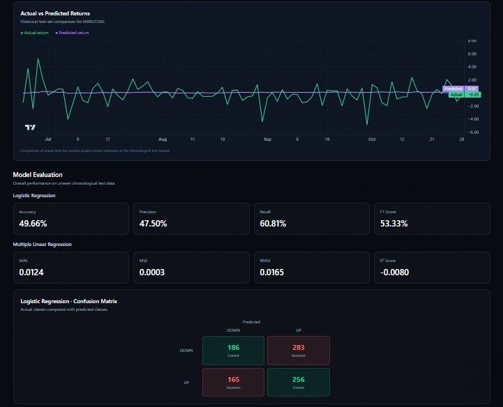
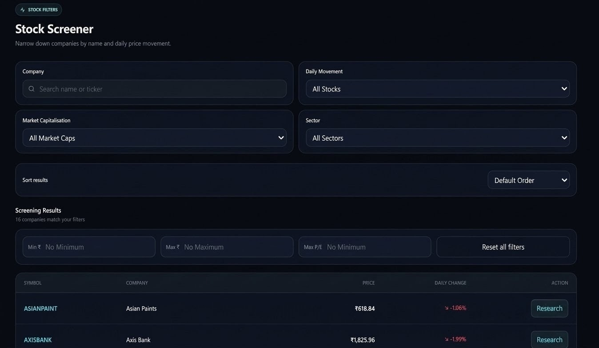
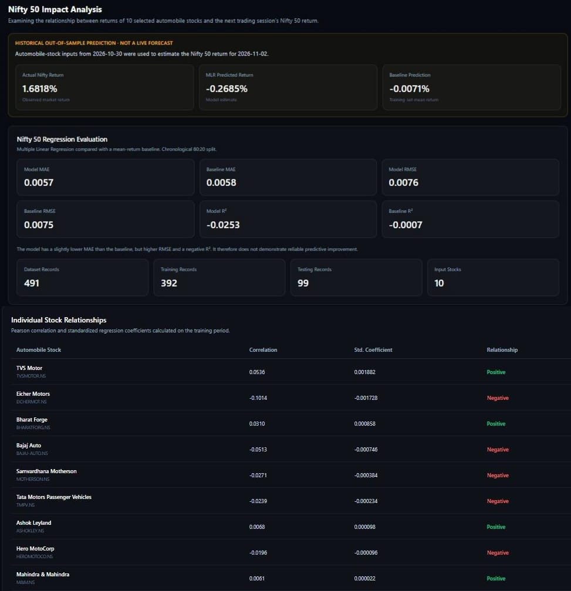

# Tavrixa

### Intelligence Before Investment.

**Tavrixa** is a stock research and portfolio analysis platform designed to bring market exploration, financial screening, technical analysis, and simulated investing into one workspace.

It combines an interactive React interface with Supabase-powered user functionality and a Python-based Quant Engine for experimental machine learning-driven stock analysis.

<p align="center">
  <a href="https://tavrixa.vercel.app/">
    <strong>Explore Tavrixa →</strong>
  </a>
</p>

---

## Screenshots

### Overview Dashboard



### Paper Trading



### Quant Engine

The Quant Engine explores historical automotive-sector stock data using machine learning models and technical indicators.





### Stock Screener



### Nifty 50 Impact Analysis

Historical analysis of relationships between selected automobile-sector stocks and Nifty 50 returns.



---

## Key Features

- **Market Overview:** A centralized dashboard for exploring market information and tracking selected stocks.
- **Stock Discovery & Screener:** Explore listed companies and filter stocks using available financial and valuation metrics.
- **Interactive Charts:** Historical price visualization with multiple chart views, selectable time ranges, and technical indicators such as Simple Moving Averages (SMA).
- **Paper Trading:** Simulate stock transactions without using real money, with virtual capital, holdings, and transaction history.
- **Portfolio Analytics:** Track simulated portfolio performance, allocation, and profit/loss.
- **Watchlists & Alerts:** Keep track of selected stocks and monitor relevant market movements.
- **Research & Comparison:** Explore company information and compare stocks using available financial metrics.
- **Quant Engine:** An experimental analytical module combining Logistic Regression and Multiple Linear Regression for automotive stock analysis, historical backtesting, model evaluation, and statistical analysis of relationships between selected automobile-sector stocks and Nifty 50 returns.

---

## Quant Engine – Machine Learning

The Quant Engine is a Python-based analytical service integrated with the Tavrixa frontend.

Its current implementation focuses on selected automobile-sector companies and uses historical market data to develop predictive features.

The workflow includes:

1. **Historical Data Collection** – Gathering historical stock market data.
2. **Feature Engineering** – Preparing market features and technical indicators from historical price data.
3. **Model Development** – Applying Multiple Linear Regression and Logistic Regression approaches.
4. **Prediction & Analysis** – Exposing model outputs and historical analysis through an API.
5. **Frontend Integration** – Displaying results and historical charts inside Tavrixa.


### Nifty 50 Impact Analysis

Alongside its stock prediction models, the Quant Engine includes a separate statistical analysis module that examines historical relationships between ten selected automobile-sector companies and Nifty 50 returns.

The analysis includes:

- Pearson correlation analysis to examine historical relationships.
- Standardized regression coefficients to study the relative statistical associations of selected stocks with Nifty 50 returns.
- Historical index-return analysis and backtesting.

This analysis identifies statistical relationships, not causation or actual index contribution weights.

The Quant Engine is an experimental research component. Its outputs are not guaranteed predictions and should not be treated as financial advice.

---

## Technology Stack

| Layer | Technologies |
|---|---|
| Frontend | React, TypeScript, Vite |
| Styling | Tailwind CSS |
| Charts | Lightweight Charts |
| UI & Animation | Lucide React, Motion |
| 3D Visualization | Three.js, React Three Fiber, Drei |
| Authentication & Database | Supabase |
| Machine Learning Service | Python, FastAPI |
| Frontend Deployment | Vercel |
| Quant Engine Deployment | Render |

---

## Architecture

Tavrixa uses a frontend application connected to backend services for authentication, data persistence, and machine learning functionality.

                  TAVRIXA
                     |
              React + TypeScript
                     |
          -------------------------
          |                       |
       Supabase              Quant Engine API
          |                       |
    Authentication          Python + FastAPI
    PostgreSQL                     |
    User Data             ---------------------
    RLS Policies           |                   |
                     ML Processing      Statistical Analysis
                          |                   |
                  Stock Predictions    Nifty 50 Analysis

- **React frontend:** Handles the user interface, navigation, charts, and application workflows.
- **Supabase:** Provides authentication and database functionality for user-specific application data.
- **Quant Engine:** Processes historical market data and returns machine learning analysis through an API.

---

## Getting Started

### Prerequisites

- Node.js and npm
- A Supabase project with the required database configuration

### Installation

Clone the repository:

```bash
git clone https://github.com/mhchy10/Tavrixa.git
```

Navigate to the project directory:

```bash
cd Tavrixa
```

Install dependencies:

```bash
npm install
```

### Environment Variables

Create a `.env` file in the project root:

```env
VITE_SUPABASE_URL=your_supabase_project_url
VITE_SUPABASE_PUBLISHABLE_KEY=your_supabase_publishable_key
```

Use your own Supabase project credentials. Never commit private keys or secrets to GitHub.

### Run Locally

```bash
npm run dev
```

### Production Build

```bash
npm run build
```

---

## Deployment

- **Frontend:** Deployed using Vercel.
- **Quant Engine:** Python API deployed separately using Render.
- **Database and Authentication:** Supabase.

Live application: https://tavrixa.vercel.app/

---

## Limitations & Disclaimer

- Market information and historical data depend on the underlying data sources and their availability.
- Machine learning outputs are experimental and may be inaccurate.
- Historical performance does not guarantee future results.
- Paper Trading is a simulation and does not execute real market orders.
- Tavrixa is an educational and analytical project, not a registered investment advisory service.

---

## License

This project is licensed under the [MIT License](LICENSE).